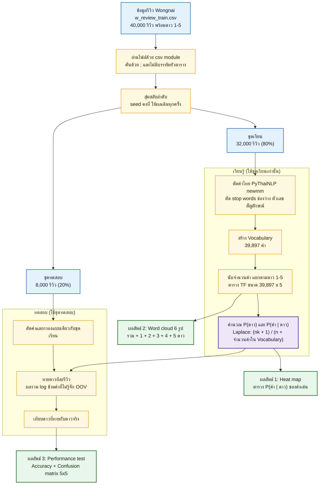

# Naive Bayes จำแนกดาวรีวิวร้านอาหารไทย (Wongnai)

เอกสารโจทย์ ขอบเขต และผลลัพธ์ของงาน (เขียนก่อนเริ่มลงมือทำ)
อัปเดตล่าสุด: 6 พ.ย. 2026

---

## 1. ภาพรวมโจทย์

ทำ **Naive Bayes classifier** ตามเนื้อหา `08 Bayesian Learning.pptx` (สไลด์ 22-29) เพื่อ **ทายจำนวนดาว (1-5) จากข้อความรีวิวร้านอาหารภาษาไทย** โดยใช้ตัวอย่างลายมือใน `NB.pdf` เป็นแนวทางว่าต้องคำนวณอย่างไร

หลักการคือ นับว่าแต่ละคำพบบ่อยแค่ไหนในรีวิวของแต่ละระดับดาว แล้วเมื่อเจอรีวิวใหม่ ให้ดูว่าคำในรีวิวนั้น "เข้ากับ" ดาวไหนมากที่สุด

เขียนแบบเบสิกธรรมดา ไม่ซับซ้อนเหมือนงานอื่นๆ ใช้ไลบรารีพื้นฐาน (numpy, matplotlib) บวก Thai NLP (PyThaiNLP) และเพิ่มอีกเพียง 1 ตัวคือ `wordcloud` สำหรับวาด word cloud (รายละเอียดในข้อ 7)

### ข้อความโจทย์ตามที่ได้รับ
- heat map
- word cloud ของ รวม, 1 ดาว, 2 ดาว, 3 ดาว, 4 ดาว, 5 ดาว ทั้งหมดมี 6 รูป เพื่อดูว่าคำไหนมีอิทธิพลต่อการให้ดาว
- performance test ได้เท่าไหร่ (Accuracy)
- ใช้ Thai NLP
- (โน้ตเดิมเขียนว่า "500000 x 5" ดูหมายเหตุในข้อ 3.5)

---

## 2. สิ่งที่ได้จากเอกสารประกอบ

### 2.1 สไลด์ `08 Bayesian Learning.pptx` (37 หน้า) ส่วนที่ใช้
| สไลด์ | เนื้อหา | ใช้ในงานนี้ |
|---|---|---|
| 9-10 | Bayes theorem, MAP | พื้นฐานของการเลือกดาวที่น่าจะเป็นที่สุด |
| 20-22 | Naive Bayes, สมมติฐานว่าคำแต่ละคำเป็นอิสระกันเมื่อรู้ดาว | หัวใจของวิธี |
| 24 | อัลกอริทึม Learn (นับ P(v) และ P(a given v)) / Classify | โครงของโค้ด |
| 26 | m-estimate ป้องกันความน่าจะเป็นเป็น 0 | อ้างอิง (งานนี้ใช้ Laplace ตามสไลด์ 29) |
| 27-29 | Naive Bayes กับการจัดหมวดข้อความ | **สูตรหลักของงานนี้** |

### 2.2 สูตรหลัก (สไลด์ 29: Naive Bayes text classification)
- **Learn**
  - `P(v_j) = |docs_j| / |Examples|` (สัดส่วนรีวิวของดาว j)
  - `text_j` = ต่อรีวิวทุกอันของดาว j เป็นข้อความเดียว, `n` = จำนวนคำทั้งหมดใน `text_j`
  - `P(w_k | v_j) = (n_k + 1) / (n + |Vocabulary|)` (Laplace smoothing; `n_k` = จำนวนครั้งที่คำ `w_k` อยู่ใน `text_j`)
- **Classify**
  - `v_NB = argmax_j  P(v_j) × ∏_k P(w_k | v_j)` โดยคิดเฉพาะคำใน Doc ที่อยู่ใน Vocabulary (คำที่ไม่เคยเจอตอนเรียน หรือ OOV จะข้าม)
- **ข้อเพิ่มเติมจากสไลด์ (เล็กน้อย):** ใช้ผลรวมของ `log` แทนผลคูณ เพราะรีวิวยาวมีคำเป็นร้อย ค่าความน่าจะเป็นคูณกันแล้วเล็กจนเป็น 0

### 2.3 ตัวอย่างลายมือ `NB.pdf` (1 หน้า) อ่านได้ดังนี้
**ชุดเรียน (training set)**
1. "I love this product" → Y
2. "He loves this product" → Y
3. "She hates this product" → N

**ชุดทดสอบ (test):** "John love this product" → Y หรือ N ?
- `John` = OOV (ไม่อยู่ใน vocabulary → ข้าม), `this` = stop word (ตัดทิ้ง)

**ขั้นเตรียมข้อมูล:** ตัด stop words (this) → stemming (loves→love, hates→hate) → vocabulary = {I, love, product, He, She, hate} (|V| = 6)

**ตาราง TF (จำนวนคำ) ของแต่ละคลาส**
| | I | love | product | He | She | hate | รวมคำ (n) |
|---|---|---|---|---|---|---|---|
| Y | 1 | 2 | 2 | 1 | 0 | 0 | 6 |
| N | 0 | 0 | 1 | 0 | 1 | 1 | 3 |

**บวก 1 (Laplace) แล้วหารด้วย n + |V|** (Y: 6+6 = 12, N: 3+6 = 9)
| | I | love | product | He | She | hate |
|---|---|---|---|---|---|---|
| P(w\|Y) | 2/12 | 3/12 | 3/12 | 2/12 | 1/12 | 1/12 |
| P(w\|N) | 1/9 | 1/9 | 2/9 | 1/9 | 2/9 | 2/9 |

**ทาย:** เหลือคำ love, product ; P(Y) = 2/3, P(N) = 1/3
- Y: 2/3 × 3/12 × 3/12 ≈ **0.042**
- N: 1/3 × 1/9 × 2/9 ≈ **0.008**
- ผล: **Y** (ในลายมือตัวหารเขียนเป็น 8 กับ 7 ได้ 0.094 กับ 0.014 ซึ่งไม่ตรงกับสูตร n+|V| ของสไลด์ แต่คำตอบสุดท้ายยังเป็น Y เหมือนกัน; งานนี้ยึดสูตรสไลด์)

**ผลลัพธ์ที่เขียนไว้ในมุมของลายมือ:** ลูกศรชี้ตาราง P(w|v) ว่า `heat map`, มุมขวาเขียน `word cloud` แยก รวม/1/2/3/4/5 และ `performance test Accuracy`

---

## 3. ข้อมูล (Dataset)

### 3.1 แหล่งข้อมูล
- Repo: https://github.com/wongnai/wongnai-corpus (License: LGPL-3.0)
- ใช้ชุด **Review dataset**: `review/review_dataset.zip` (14.3 MB) ซึ่งมาจากการแข่ง Kaggle ของ ดร.เอกพล ช่วงสุวนิช (Dr. Ekapol Chuangsuwanich)

### 3.2 ไฟล์ใน zip
| ไฟล์ | ขนาด | จำนวน | มีดาวเฉลย | การใช้งาน |
|---|---|---|---|---|
| `w_review_train.csv` | 60 MB | **40,000 รีวิว** | มี | **ใช้เรียนและทดสอบ** |
| `test_file.csv` | 9.9 MB | 6,203 รีวิว | **ไม่มี** | ไม่ใช้ (วัดผลไม่ได้) |
| `sample_submission.csv` | 32 B | 4 แถว | - | แค่ตัวอย่างรูปแบบไฟล์ส่งงาน Kaggle |

### 3.3 รูปแบบไฟล์ `w_review_train.csv` (สิ่งที่ต้องระวังตอนอ่าน)
- คั่นคอลัมน์ด้วย `;` และ **ไม่มีบรรทัดหัวตาราง** (บรรทัดแรกคือรีวิวจริง)
- 2 คอลัมน์: ข้อความรีวิว, ดาว (1-5)
- ข้อความรีวิวอยู่ในเครื่องหมาย `"..."` และ **มีการขึ้นบรรทัดใหม่ในรีวิวเดียวกัน** จึงต้องอ่านด้วย `csv` module ของ Python (อ่านทีละบรรทัดแล้วแยก `;` เองไม่ได้)
- รีวิวยาวเฉลี่ย ~540 ตัวอักษร (มัธยฐาน 371, ยาวสุด ~20,000)

### 3.4 การกระจายของดาว (ไม่สมดุลมาก)
| ดาว | จำนวนรีวิว | สัดส่วน |
|---|---|---|
| 1 | 415 | 1.0% |
| 2 | 1,845 | 4.6% |
| 3 | 12,171 | 30.4% |
| 4 | 18,770 | 46.9% |
| 5 | 6,799 | 17.0% |
| รวม | 40,000 | 100% |

ผลที่ตามมา: การเดา "4 ดาว" ตลอดก็ได้ accuracy ประมาณ 46% และโมเดลมักทายไปที่ 3-4 ดาว

### 3.5 หมายเหตุเรื่อง "500000 x 5"
- เลข 500,000 ใน repo เป็น **ชุดข้อมูลคำค้นหา (search query)** ใช้ทำงานตัดคำ ไม่เกี่ยวกับรีวิวและไม่มีดาว **งานนี้ไม่ใช้**
- ตารางคำ × 5 ดาวของงานนี้มี **39,897 × 5** (39,897 = จำนวนคำไม่ซ้ำใน Vocabulary ไม่ใช่จำนวนรีวิว)

### 3.6 วิธีแบ่งข้อมูลเพื่อวัดผล
สุ่มสลับลำดับ (ตั้ง seed) แล้วแบ่งจาก `w_review_train.csv` เป็น **32,000 รีวิวไว้เรียน / 8,000 รีวิวไว้ทดสอบ** (80/20)

---

## 4. ขั้นตอนการทำ (pipeline)
1. อ่าน `w_review_train.csv` ด้วย `csv` module → ได้รายการ (ข้อความ, ดาว)
2. สลับลำดับแบบสุ่ม (seed คงที่) แล้วแบ่งชุดเรียน/ชุดทดสอบ
3. **ตัดคำไทย** ด้วย PyThaiNLP (`newmm`) → ตัดช่องว่างและ stop words ภาษาไทยของ PyThaiNLP (1,030 คำ) → ตัดคำที่ไม่ใช่ตัวอักษร (ตัวเลข สัญลักษณ์)
4. สร้าง Vocabulary จากชุดเรียนเท่านั้น (39,897 คำ)
5. **Learn:** นับ P(ดาว) และตาราง P(คำ | ดาว) ขนาด |V| × 5 ด้วย Laplace
6. **Classify:** ทายดาวของชุดทดสอบด้วยผลรวม log ข้ามคำ OOV
7. คำนวณ accuracy และ confusion matrix
8. ทำภาพ 3 ชุด (ข้อ 5)

หมายเหตุ: ไม่ทำ stemming เพราะภาษาไทยไม่มีการผันคำเหมือน loves/hates

### 4.1 ไดอะแกรมภาพรวมของงาน

(เขียนด้วยโค้ด Mermaid ฝังในไฟล์นี้ แสดงเป็นภาพบน GitHub, VS Code และ PyCharm ที่เปิดตัวแสดงผล Markdown ได้)

