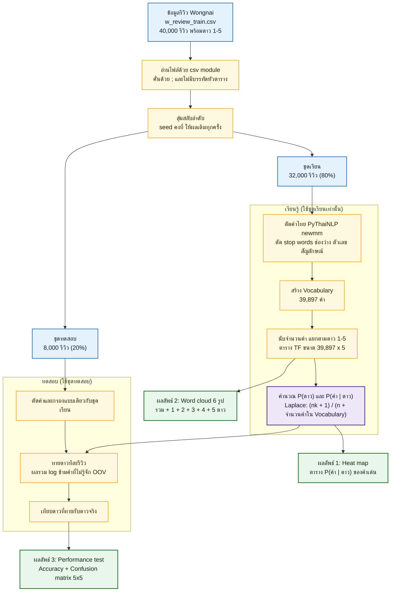
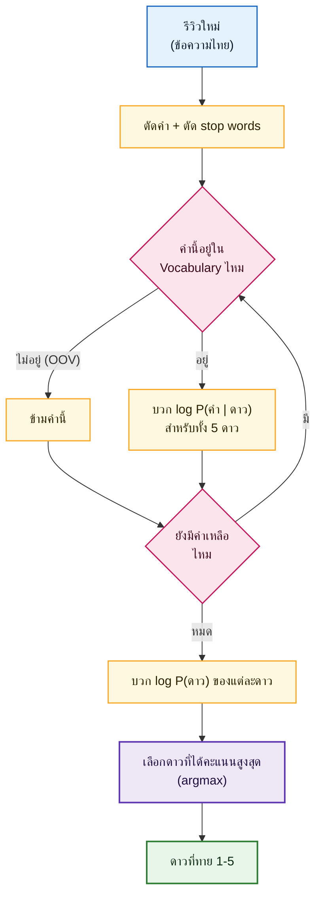

# Naive Bayes จำแนกดาวรีวิวร้านอาหารไทย (Wongnai)

เอกสารโจทย์ ขอบเขต และผลลัพธ์ของงาน (เขียนก่อนเริ่มลงมือทำ)
อัปเดตล่าสุด: 6 พ.ย. 2026

---

## 1. ภาพรวมโจทย์

ทำ **Naive Bayes classifier** ตามเนื้อหา `08 Bayesian Learning.pptx` (สไลด์ 22-29) เพื่อ **ทายจำนวนดาว (1-5) จากข้อความรีวิวร้านอาหารภาษาไทย** โดยใช้ตัวอย่างลายมือใน `NB.pdf` เป็นแนวทางว่าต้องคำนวณอย่างไร

หลักการคือ นับว่าแต่ละคำพบบ่อยแค่ไหนในรีวิวของแต่ละระดับดาว แล้วเมื่อเจอรีวิวใหม่ ให้ดูว่าคำในรีวิวนั้น "เข้ากับ" ดาวไหนมากที่สุด

เขียนแบบเบสิกธรรมดา ไม่ซับซ้อนเหมือนงานอื่นๆ ใช้ไลบรารีพื้นฐาน (numpy, matplotlib) บวก Thai NLP (PyThaiNLP) และเพิ่มอีกเพียง 1 ตัวคือ `wordcloud` สำหรับวาด word cloud (รายละเอียดในข้อ 7)

### ข้อความโจทย์ตามที่ได้รับ
- heat map
- word cloud ของ รวม, 1 ดาว, 2 ดาว, 3 ดาว, 4 ดาว, 5 ดาว ทั้งหมดมี 6 รูป เพื่อดูว่าคำไหนมีอิทธิพลต่อการให้ดาว
- performance test ได้เท่าไหร่ (Accuracy)
- ใช้ Thai NLP
- (โน้ตเดิมเขียนว่า "500000 x 5" ดูหมายเหตุในข้อ 3.5)

---

## 2. สิ่งที่ได้จากเอกสารประกอบ

### 2.1 สไลด์ `08 Bayesian Learning.pptx` (37 หน้า) ส่วนที่ใช้
| สไลด์ | เนื้อหา | ใช้ในงานนี้ |
|---|---|---|
| 9-10 | Bayes theorem, MAP | พื้นฐานของการเลือกดาวที่น่าจะเป็นที่สุด |
| 20-22 | Naive Bayes, สมมติฐานว่าคำแต่ละคำเป็นอิสระกันเมื่อรู้ดาว | หัวใจของวิธี |
| 24 | อัลกอริทึม Learn (นับ P(v) และ P(a given v)) / Classify | โครงของโค้ด |
| 26 | m-estimate ป้องกันความน่าจะเป็นเป็น 0 | อ้างอิง (งานนี้ใช้ Laplace ตามสไลด์ 29) |
| 27-29 | Naive Bayes กับการจัดหมวดข้อความ | **สูตรหลักของงานนี้** |

### 2.2 สูตรหลัก (สไลด์ 29: Naive Bayes text classification)
- **Learn**
  - `P(v_j) = |docs_j| / |Examples|` (สัดส่วนรีวิวของดาว j)
  - `text_j` = ต่อรีวิวทุกอันของดาว j เป็นข้อความเดียว, `n` = จำนวนคำทั้งหมดใน `text_j`
  - `P(w_k | v_j) = (n_k + 1) / (n + |Vocabulary|)` (Laplace smoothing; `n_k` = จำนวนครั้งที่คำ `w_k` อยู่ใน `text_j`)
- **Classify**
  - `v_NB = argmax_j  P(v_j) × ∏_k P(w_k | v_j)` โดยคิดเฉพาะคำใน Doc ที่อยู่ใน Vocabulary (คำที่ไม่เคยเจอตอนเรียน หรือ OOV จะข้าม)
- **ข้อเพิ่มเติมจากสไลด์ (เล็กน้อย):** ใช้ผลรวมของ `log` แทนผลคูณ เพราะรีวิวยาวมีคำเป็นร้อย ค่าความน่าจะเป็นคูณกันแล้วเล็กจนเป็น 0

### 2.3 ตัวอย่างลายมือ `NB.pdf` (1 หน้า) อ่านได้ดังนี้
**ชุดเรียน (training set)**
1. "I love this product" → Y
2. "He loves this product" → Y
3. "She hates this product" → N

**ชุดทดสอบ (test):** "John love this product" → Y หรือ N ?
- `John` = OOV (ไม่อยู่ใน vocabulary → ข้าม), `this` = stop word (ตัดทิ้ง)

**ขั้นเตรียมข้อมูล:** ตัด stop words (this) → stemming (loves→love, hates→hate) → vocabulary = {I, love, product, He, She, hate} (|V| = 6)

**ตาราง TF (จำนวนคำ) ของแต่ละคลาส**
| | I | love | product | He | She | hate | รวมคำ (n) |
|---|---|---|---|---|---|---|---|
| Y | 1 | 2 | 2 | 1 | 0 | 0 | 6 |
| N | 0 | 0 | 1 | 0 | 1 | 1 | 3 |

**บวก 1 (Laplace) แล้วหารด้วย n + |V|** (Y: 6+6 = 12, N: 3+6 = 9)
| | I | love | product | He | She | hate |
|---|---|---|---|---|---|---|
| P(w\|Y) | 2/12 | 3/12 | 3/12 | 2/12 | 1/12 | 1/12 |
| P(w\|N) | 1/9 | 1/9 | 2/9 | 1/9 | 2/9 | 2/9 |

**ทาย:** เหลือคำ love, product ; P(Y) = 2/3, P(N) = 1/3
- Y: 2/3 × 3/12 × 3/12 ≈ **0.042**
- N: 1/3 × 1/9 × 2/9 ≈ **0.008**
- ผล: **Y** (ในลายมือตัวหารเขียนเป็น 8 กับ 7 ได้ 0.094 กับ 0.014 ซึ่งไม่ตรงกับสูตร n+|V| ของสไลด์ แต่คำตอบสุดท้ายยังเป็น Y เหมือนกัน; งานนี้ยึดสูตรสไลด์)

**ผลลัพธ์ที่เขียนไว้ในมุมของลายมือ:** ลูกศรชี้ตาราง P(w|v) ว่า `heat map`, มุมขวาเขียน `word cloud` แยก รวม/1/2/3/4/5 และ `performance test Accuracy`

---

## 3. ข้อมูล (Dataset)

### 3.1 แหล่งข้อมูล
- Repo: https://github.com/wongnai/wongnai-corpus (License: LGPL-3.0)
- ใช้ชุด **Review dataset**: `review/review_dataset.zip` (14.3 MB) ซึ่งมาจากการแข่ง Kaggle ของ ดร.เอกพล ช่วงสุวนิช (Dr. Ekapol Chuangsuwanich)

### 3.2 ไฟล์ใน zip
| ไฟล์ | ขนาด | จำนวน | มีดาวเฉลย | การใช้งาน |
|---|---|---|---|---|
| `w_review_train.csv` | 60 MB | **40,000 รีวิว** | มี | **ใช้เรียนและทดสอบ** |
| `test_file.csv` | 9.9 MB | 6,203 รีวิว | **ไม่มี** | ไม่ใช้ (วัดผลไม่ได้) |
| `sample_submission.csv` | 32 B | 4 แถว | - | แค่ตัวอย่างรูปแบบไฟล์ส่งงาน Kaggle |

### 3.3 รูปแบบไฟล์ `w_review_train.csv` (สิ่งที่ต้องระวังตอนอ่าน)
- คั่นคอลัมน์ด้วย `;` และ **ไม่มีบรรทัดหัวตาราง** (บรรทัดแรกคือรีวิวจริง)
- 2 คอลัมน์: ข้อความรีวิว, ดาว (1-5)
- ข้อความรีวิวอยู่ในเครื่องหมาย `"..."` และ **มีการขึ้นบรรทัดใหม่ในรีวิวเดียวกัน** จึงต้องอ่านด้วย `csv` module ของ Python (อ่านทีละบรรทัดแล้วแยก `;` เองไม่ได้)
- รีวิวยาวเฉลี่ย ~540 ตัวอักษร (มัธยฐาน 371, ยาวสุด ~20,000)

### 3.4 การกระจายของดาว (ไม่สมดุลมาก)
| ดาว | จำนวนรีวิว | สัดส่วน |
|---|---|---|
| 1 | 415 | 1.0% |
| 2 | 1,845 | 4.6% |
| 3 | 12,171 | 30.4% |
| 4 | 18,770 | 46.9% |
| 5 | 6,799 | 17.0% |
| รวม | 40,000 | 100% |

ผลที่ตามมา: การเดา "4 ดาว" ตลอดก็ได้ accuracy ประมาณ 46% และโมเดลมักทายไปที่ 3-4 ดาว

### 3.5 หมายเหตุเรื่อง "500000 x 5"
- เลข 500,000 ใน repo เป็น **ชุดข้อมูลคำค้นหา (search query)** ใช้ทำงานตัดคำ ไม่เกี่ยวกับรีวิวและไม่มีดาว **งานนี้ไม่ใช้**
- ตารางคำ × 5 ดาวของงานนี้มี **39,897 × 5** (39,897 = จำนวนคำไม่ซ้ำใน Vocabulary ไม่ใช่จำนวนรีวิว)

### 3.6 วิธีแบ่งข้อมูลเพื่อวัดผล
สุ่มสลับลำดับ (ตั้ง seed) แล้วแบ่งจาก `w_review_train.csv` เป็น **32,000 รีวิวไว้เรียน / 8,000 รีวิวไว้ทดสอบ** (80/20)

---

## 4. ขั้นตอนการทำ (pipeline)
1. อ่าน `w_review_train.csv` ด้วย `csv` module → ได้รายการ (ข้อความ, ดาว)
2. สลับลำดับแบบสุ่ม (seed คงที่) แล้วแบ่งชุดเรียน/ชุดทดสอบ
3. **ตัดคำไทย** ด้วย PyThaiNLP (`newmm`) → ตัดช่องว่างและ stop words ภาษาไทยของ PyThaiNLP (1,030 คำ) → ตัดคำที่ไม่ใช่ตัวอักษร (ตัวเลข สัญลักษณ์)
4. สร้าง Vocabulary จากชุดเรียนเท่านั้น (39,897 คำ)
5. **Learn:** นับ P(ดาว) และตาราง P(คำ | ดาว) ขนาด |V| × 5 ด้วย Laplace
6. **Classify:** ทายดาวของชุดทดสอบด้วยผลรวม log ข้ามคำ OOV
7. คำนวณ accuracy และ confusion matrix
8. ทำภาพ 3 ชุด (ข้อ 5)

หมายเหตุ: ไม่ทำ stemming เพราะภาษาไทยไม่มีการผันคำเหมือน loves/hates

### 4.1 ไดอะแกรมภาพรวมของงาน

(เขียนด้วยโค้ด Mermaid ฝังในไฟล์นี้ แสดงเป็นภาพบน GitHub, VS Code และ PyCharm ที่เปิดตัวแสดงผล Markdown ได้)



### 4.2 ไดอะแกรมการทายดาวของ 1 รีวิว (Classify)



---

## 5. ผลลัพธ์ที่ต้องการ (3 อย่าง)

### 5.1 Heat map
- แผนที่สีของตาราง **P(คำ | ดาว)** (เทียบกับตารางสีน้ำเงินในลายมือ)
- แถว = ดาว 1-5, คอลัมน์ = คำเด่นจำนวนหนึ่ง (เช่น 20-30 คำ) เพราะคำทั้งหมด ~40,000 คำแสดงในภาพเดียวไม่ได้
- สีเข้ม = คำนั้นพบบ่อยในรีวิวระดับดาวนั้น (ใส่ฟอนต์ไทยให้ชื่อคำอ่านออก)

### 5.2 Word cloud 6 รูป
- **รวม** (ทุกดาว) + **1, 2, 3, 4, 5 ดาว** แสดงเป็นกริด 2×3
- ตอบคำถาม "คำไหนมีอิทธิพลต่อการให้ดาว"
- ขนาดคำ: รูป "รวม" ใช้ความถี่ ส่วน 5 ดาวใช้ "คำที่โดดเด่นเมื่อเทียบกับดาวอื่น" (log-odds และตั้งจำนวนครั้งขั้นต่ำ) เพราะถ้าใช้ความถี่ธรรมดา ทั้ง 5 ภาพจะหน้าตาคล้ายกัน (คำว่า อร่อย, ร้าน, อาหาร)

### 5.3 Performance test
- วัด **accuracy** บนชุดทดสอบ 8,000 รีวิว: `ทายถูก ÷ 8,000`
- แสดงเป็น **confusion matrix 5×5** (แถว = ดาวจริง, คอลัมน์ = ดาวที่ทาย) พร้อมตัวเลข accuracy และเทียบกับ baseline ที่เดา 4 ดาวตลอด
- accuracy เป็นตัวหลักตามลายมือ ไม่เพิ่มตัวชี้วัดอื่น

---

## 6. ขอบเขต

### ทำ
- Naive Bayes ตามสูตรสไลด์ 29 พร้อม Laplace
- ตัดคำไทยและตัด stop words ด้วย PyThaiNLP
- 3 ผลลัพธ์ในข้อ 5 (heat map, word cloud 6 รูป, performance test)
- เขียนแบบเบสิก อ่านง่าย มีคอมเมนต์สั้นๆ

### ไม่ทำ
- ไม่ทำ stemming
- ไม่ใช้ชุดข้อมูลคำค้นหา 500,000 คำ และไม่ใช้ `test_file.csv` (ไม่มีเฉลย)
- ไม่ปรับโมเดลให้แม่นขึ้น (เช่น TF-IDF, n-gram, m-estimate) ไม่ใช้ sklearn / pandas
- ไม่ทำเว็บหรือแอป

### รายการส่งมอบ (checklist)
งานถือว่าเสร็จเมื่อครบทุกข้อ (ติ๊กตอนทำเสร็จ)

**โค้ดและข้อมูล**
- [x] โน้ตบุ๊กเดียวที่รันตั้งแต่ต้นจนจบได้ ไม่ error (ผลซ้ำเดิมทุกครั้งเพราะตั้ง seed)
- [x] มีเซลล์ตรวจว่ามี `data/w_review_train.csv` หรือยัง ถ้ายังให้โหลดจาก GitHub ให้เอง
- [x] อ่านข้อมูลได้ครบ 40,000 รีวิว (พิมพ์จำนวนรีวิวและการกระจายของดาว 1-5 ยืนยัน)
- [x] แบ่ง 32,000 เรียน / 8,000 ทดสอบ (พิมพ์จำนวนยืนยัน)
- [x] ตัดคำไทยด้วย PyThaiNLP และตัด stop words ได้ (แสดงตัวอย่างรีวิวก่อน/หลังตัดคำ 1-2 รีวิว)
- [x] สร้าง Vocabulary จากชุดเรียนเท่านั้น (พิมพ์จำนวนคำ)
- [x] Learn: ได้ P(ดาว) และตาราง P(คำ | ดาว) ด้วย Laplace ตามสไลด์ 29
- [x] Classify: ทายดาวของชุดทดสอบด้วยผลรวม log ข้ามคำ OOV
- [x] มีคอมเมนต์สั้นๆ บอกว่าแต่ละส่วนทำอะไร และตัวแปรสำคัญใช้ชื่อที่อ่านง่าย

**ผลลัพธ์ 3 อย่าง**
- [x] Heat map 1 ภาพ: P(คำ | ดาว) ของคำเด่น 20-30 คำ มีป้ายดาวและคำเป็นภาษาไทยอ่านออก
- [x] Word cloud 6 รูป: รวม, 1, 2, 3, 4, 5 ดาว ฟอนต์ไทยถูกต้อง (ไม่มีกล่องว่าง) และแต่ละรูปมีชื่อกำกับ
- [x] Performance test: แสดง accuracy (ตัวเลข %) บนชุดทดสอบ 8,000 รีวิว
- [x] Confusion matrix 5×5 พร้อมป้ายแกน และเทียบกับ baseline เดา 4 ดาวตลอด

**เอกสารและ repo**
- [x] `Ice.md` ตรงกับสิ่งที่ทำจริง (ปรับสถานะ "ยังเปิดอยู่" ให้ครบ และใส่ accuracy จริงแทนผลต้นแบบ)
- [x] ฟอนต์ `fonts/Sarabun-Regular.ttf` พร้อม `fonts/OFL.txt` อยู่ในโปรเจกต์
- [x] `data/` ถูก `.gitignore` ไม่ขึ้น repo
- [x] ผูก remote `IdeaMee/Naive_Bayes_Thai_Review` ได้ถูกต้อง (push ได้เมื่อสั่ง)

---

## 7. เครื่องมือ

| เครื่องมือ | เวอร์ชัน (interpreter ของโปรเจกต์) | หน้าที่ |
|---|---|---|
| Python | 3.14.7 (miniconda3 ที่ PyCharm ใช้กับโปรเจกต์ ML) | ภาษาหลัก |
| numpy | 2.5.2 | คำนวณตารางความน่าจะเป็น |
| matplotlib | 3.11.2 | heat map, confusion matrix, แสดงภาพ |
| pythainlp | 5.3.7 | ตัดคำไทย (`newmm`), stop words ไทย |
| wordcloud | 1.9.6 | word cloud (เพิ่มติดตั้งเพิ่มสำหรับงานนี้) |
| pillow | 12.3.0 | ตัวช่วยของ wordcloud |
| csv (มาตรฐาน) | - | อ่านไฟล์รีวิว |

ถ้ารันแล้วขึ้น `ModuleNotFoundError: No module named 'wordcloud'` แปลว่า interpreter ที่ใช้รันยังไม่มีไลบรารีนั้น ให้ติดตั้งใน interpreter เดียวกับที่รัน (ใน PyCharm กด Install Package หรือรัน `python -m pip install wordcloud` ด้วย Python ตัวนั้น) ผลที่ได้เหมือนกันทั้ง Python 3.13 และ 3.14 (ทดสอบแล้ว Accuracy 51.2%)

- **ฟอนต์ไทย: Sarabun** (`fonts/Sarabun-Regular.ttf` 90 KB พร้อม `fonts/OFL.txt`) จาก Google Fonts, License SIL OFL 1.1 ใช้วาดตัวอักษรไทยใน word cloud (`font_path`) และป้ายใน matplotlib (heat map, confusion matrix) เท่านั้น ไม่เกี่ยวกับการคำนวณ เก็บไว้ในโปรเจกต์เพื่อให้รันได้ทุกเครื่อง
- ทดสอบแล้ว: ตัดคำไทย, stop words 1,030 คำ, word cloud และ heat map ที่มีป้ายภาษาไทยด้วยฟอนต์ Sarabun ทำงานได้
- **ไลบรารีที่เพิ่มจากพื้นฐาน (numpy + matplotlib):** `pythainlp` (ตัดคำไทยและ stop words) และ `wordcloud` (วาด word cloud) ส่วน `pillow` ติดมากับ matplotlib/wordcloud อยู่แล้ว ไม่ใช้ pandas, sklearn, seaborn

---

## 8. ผลจริงจากโน้ตบุ๊ก `NB_Thai_Review.ipynb` (รันครบ ไม่มี error, ผลซ้ำเดิมเพราะตั้ง seed)
- ตัดคำ 40,000 รีวิวด้วย `newmm` ใช้เวลา ~43 วินาที (รันทั้งโน้ตบุ๊ก ~1 นาที)
- Vocabulary จากชุดเรียน 32,000 รีวิว (หลังตัด stop words) = **39,897 คำ** → ตาราง P(คำ | ดาว) ขนาด 39,897 × 5
- **Accuracy = 51.2%** (ทายถูก 4,097 จาก 8,000) เทียบกับ baseline เดา 4 ดาวตลอด 46.3%
- ทายถูกต่อดาว (จาก confusion matrix): 1★ 0/85, 2★ 26/373 (7%), 3★ 1,188/2,484 (48%), 4★ 2,612/3,702 (71%), 5★ 271/1,356 (20%) โมเดลเอนไปทาย 3-4 ดาว ทายผิดบ่อยที่สุดคือดาวใกล้กัน (3 กับ 4, 5 กับ 4)
- คำเด่น (log-odds, `MIN_COUNT = 500`): 1 ดาว: แย่, นาที, ถาม, ยืน, ชั่วโมง; 2 ดาว: ปรับปรุง, จืด, ออเดอร์, งง; 3 ดาว: พอใช้ได้, กลางๆ, ถึงกับ, ใช้ได้, โอเค; 4 ดาว: จีน, ดีงาม, เข้ากัน, กำลังดี (คำเด่นน้อยกว่าดาวอื่น เพราะ 4 ดาวเป็นดาวส่วนใหญ่); 5 ดาว: สุดยอด, ห้าม(พลาด), เชฟ, คุ้มค่า, ฟิน

---

## 9. โครงสร้างโฟลเดอร์

```
Naive_Bayes_Thai_Review/
  Ice.md                         เอกสารโจทย์ (ไฟล์นี้)
  08 Bayesian Learning.pptx      เนื้อหาประกอบ
  NB.pdf                         ตัวอย่างลายมือ
  NB_Thai_Review.ipynb            โน้ตบุ๊กหลัก (ผลงาน) พร้อมผลลัพธ์ในไฟล์
  data/                          ข้อมูลที่ดาวน์โหลดมา (ไม่ commit เพราะไฟล์ใหญ่)
  fonts/                         ฟอนต์ Sarabun + OFL.txt (ใช้กับภาพ word cloud / heat map)
  .gitignore / .gitattributes    ข้าม data/, NB.pdf, pptx และเก็บไฟล์ csv/ฟอนต์ตามไบต์เดิม
```

---

## 10. สถานะการตัดสินใจ

**ตกลงแล้ว**
- ใช้ `w_review_train.csv` 40,000 รีวิว แบ่ง 80/20 วัด accuracy
- ไม่ใช้ชุด 500K และ `test_file.csv`
- ผลลัพธ์ 3 อย่าง: heat map, word cloud 6 รูป, performance test
- ชื่อโฟลเดอร์/repo: `Naive_Bayes_Thai_Review` เชื่อม remote `https://github.com/IdeaMee/Naive_Bayes_Thai_Review.git` ไว้แล้ว
- ฟอนต์: ใช้ Sarabun เก็บไว้ในโปรเจกต์ (`fonts/`)
- ข้อมูล: เก็บ `w_review_train.csv` (60 MB, 40,000 รีวิว) ไว้ใน `data/` ในเครื่อง และใช้ `.gitignore` ไม่ให้ `data/` ขึ้น repo (ในโน้ตบุ๊กจะมีเซลล์โหลดจาก GitHub ให้ถ้ายังไม่มีไฟล์)
- word cloud: รูป "รวม" ใช้ความถี่ ส่วน 1-5 ดาวใช้ log-odds (ตั้ง `MIN_COUNT = 500`) แสดงเป็นกริด 2×3 (ภาพเดียว)
- ผลงานเป็นโน้ตบุ๊ก `NB_Thai_Review.ipynb` ไฟล์เดียว พร้อมผลลัพธ์ฝังในไฟล์
- ทำเสร็จแล้ว: โน้ตบุ๊กรันครบ ได้ heat map, word cloud 6 รูป, accuracy และ confusion matrix (ดูข้อ 8)

**ยังเปิดอยู่ (รอตัดสินใจ)**
- แผน commit ของโน้ตบุ๊ก: จะ commit ไฟล์เดียวหรือทำประวัติหลาย commit หลายคน (repo นี้มี commit จริงของคุณและเพื่อนอยู่แล้ว) และจะ push เมื่อไหร่

---

## 11. อ้างอิง
- สไลด์: `08 Bayesian Learning.pptx` (สไลด์ 22, 24, 26, 29 เป็นหลัก), ผู้สอน Parinya Sanguansat
- ตัวอย่างลายมือ: `NB.pdf`
- ชุดข้อมูล: https://github.com/wongnai/wongnai-corpus (`review/review_dataset.zip`), License LGPL-3.0
- ที่มาของข้อมูลรีวิว: การแข่ง Kaggle ของ ดร.เอกพล ช่วงสุวนิช (Dr. Ekapol Chuangsuwanich) ตามที่ระบุใน README ของ repo
